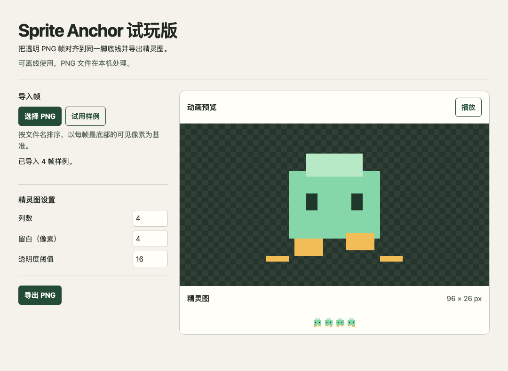

# Sprite Anchor 动画帧对齐工具

把画布大小和透明边距各异的 PNG 动画帧对齐到统一脚底线，减少动画播放时因画布对齐造成的上下抖动。

**[下载中文试玩版](https://github.com/qingDevCodes/sprite-anchor-preview/releases/download/v0.1.1/sprite-anchor-preview-zh.html)**，直接用 Chrome 打开 HTML。选择**试用样例**即可播放动画和导出样例精灵图，也可以导入最多 8 张自定义 PNG 检查对齐效果。图片在本机处理。

Sprite Anchor 已入驻[爱发电](https://afdian.com/a/spriteanchor)，付费商品待上线。

完整版可导出自定义 PNG 和 JSON，每张精灵图最多 64 帧。中国大陆拟一次性售价 **¥19.90**，付费销售待上线。

**[登记 ¥19.90 购买意向](https://github.com/qingDevCodes/sprite-anchor-preview/issues/new?title=%E6%84%BF%E6%84%8F%E4%BB%A5%20%C2%A519.90%20%E8%B4%AD%E4%B9%B0%20Sprite%20Anchor)**。登记会创建公开 Issue，无需付款。也欢迎单独反馈使用问题，填写浏览器、帧数和期待的效果即可。

[English preview](https://github.com/qingDevCodes/sprite-anchor-preview/releases/tag/v0.1.0)
