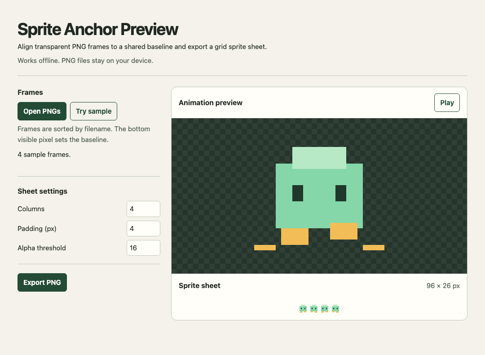

# Sprite Anchor Preview

Sprite Anchor aligns transparent PNG animation frames to a shared baseline, so uneven transparent margins do not make a walk cycle jump.

**[Download the free preview](https://github.com/qingDevCodes/sprite-anchor-preview/releases/download/v0.1.0/sprite-anchor-preview.html)** and open the HTML file in Chrome. Select **Try sample** to preview a walk cycle and export its PNG sprite sheet. Or open up to eight of your own transparent PNGs and inspect their alignment. Frame processing stays on your device.

## Full edition

The full edition adds custom PNG and JSON export and supports up to 64 frames per sheet. The proposed price is **US$7 one time**. Sales are pending.

If you would buy it at that price, [register your interest in a public GitHub issue](https://github.com/qingDevCodes/sprite-anchor-preview/issues/new?title=Interested%20in%20Sprite%20Anchor%20at%20US%247&body=What%20would%20you%20use%20Sprite%20Anchor%20for%3F%0A). This records interest and takes no payment. Use a separate issue to report a problem, with your browser, frame count, approximate dimensions, and expected result. You can report it without attaching artwork.

## 中文

Sprite Anchor 可将透明 PNG 动画帧按可见像素底边对齐。下载 HTML 后用 Chrome 打开。免费版可导入最多 8 帧，并可导出内置样例的精灵图。完整版支持最多 64 帧，可导出自定义 PNG 和 JSON，拟一次性售价 7 美元，现可登记购买意向。
